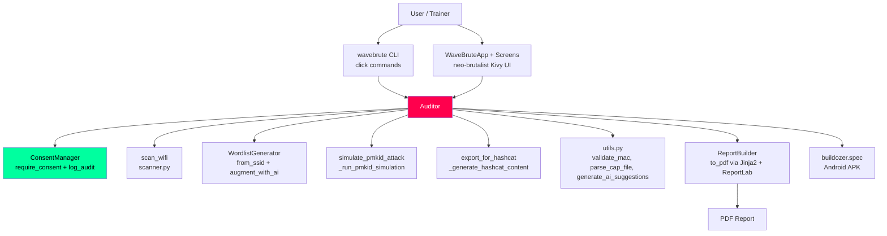

<!-- header:start -->
<div align="center">


<a href="#-quick-start"></a>

<a href="LICENSE"></a>

<a href="https://github.com/ajendras/wavebrute/stargazers"></a>
<a href="https://github.com/ajendras/wavebrute/actions/workflows/ci.yml"></a>

<a href="CONTRIBUTING.md"></a>

**Ethical WiFi auditing toolkit with Kivy GUI and Android APK for simulated and authorized pentests**

[✨ Features](#-features) • [⚡ Quick start](#-quick-start) • [🧰 Usage](#-usage) • [🧩 Architecture](#-architecture) • [📍 Roadmap](#-roadmap) • [🤝 Contributing](#-contributing)

</div>
<!-- header:end -->

## ✨ Why WaveBrute?

Existing wireless testing tools are either ancient CLIs or shady mobile apps with no ethics layer. WaveBrute fills the gap with a loud, beginner-friendly neo-brutalist GUI, safe simulation mode for classrooms, and a true Android APK. Made for security trainers, pentesters and devs who want to demonstrate WiFi weaknesses responsibly.

- **Safe-by-default simulation** — run full audits in memory with zero risk
- **Ethics Guard** — mandatory consent checklist and audit logging before any live action
- **Neo-brutalist GUI** — thick borders, screaming yellow/pink/lime blocks, chunky buttons that work on desktop and Android
- **One-command PDF reports** — professional outputs with timelines, AI hints, and responsible recommendations
- **Real Android APK** — built with Buildozer, complete with location/WiFi permissions

## 🎬 Demo

<p align="center"></p>

## 🚀 Features

<table>
<tr>
<td valign="top">🔎 <b>Live Scanner</b><br>Detects nearby networks, encryption and signal strength using Scapy wrappers</td>
<td valign="top">📖 <b>Smart Wordlists</b><br>Generates targeted dictionaries from SSID, patterns and local AI hints</td>
<td valign="top">🛡️ <b>Safe Simulation</b><br>Runs full brute-force demos in-memory without touching real networks</td>
</tr>
<tr>
<td valign="top">⚖️ <b>Ethics Guard</b><br>Mandatory consent checklist and legal warnings before any live action</td>
<td valign="top">📊 <b>PDF Reports</b><br>Creates professional audit reports with findings, timelines and recommendations</td>
<td valign="top">🧠 <b>AI Predictor</b><br>Local pattern model suggests likely passwords based on network metadata</td>
</tr>
<tr>
<td valign="top">📡 <b>Handshake Analyzer</b><br>Parses captured files for offline cracking simulation and validation</td>
<td valign="top">🔑 <b>PMKID Simulator</b><br>Simulates client-less PMKID capture and cracking (RSN IE extraction)</td>
<td valign="top">📱 <b>Android APK</b><br>Builds a native mobile app via Buildozer with location and WiFi permissions</td>
</tr>
<tr>
<td valign="top">🔨 <b>Hashcat Export</b><br>Optional .22000 file generation for real offline cracking with hashcat (simulation data + real-capture instructions)</td>
<td valign="top"></td>
<td valign="top"></td>
</tr>
</table>

## 📦 Installation

**Requirements:** Python 3.8+, `kivy`, `scapy`, `reportlab`, `jinja2`, `click`. For live scanning a wireless interface is needed (simulation mode requires nothing). For Android builds, install Buildozer.

```bash
# Install from GitHub
pip install git+https://github.com/ajendras/wavebrute.git

# Run the CLI (defaults to simulation)
wavebrute --help

# Launch the neo-brutalist GUI
python -m wavebrute.gui.app

# Build Android APK
buildozer -c android debug
```

Run tests with `pytest`.

## ⚡ Quick start

```python
from wavebrute import Auditor

# Safe simulation mode (default)
auditor = Auditor(simulation_mode=True, interface="wlan0")

# Full pipeline in one go
networks = auditor.scan()
attack = auditor.simulate_attack("Cafe_Rouge_FreeWiFi", max_attempts=5000)
pmkid = auditor.simulate_pmkid_attack("IoT-Devices")
analysis = auditor.analyze_handshake("demo.cap")
export_path = auditor.export_for_hashcat("Cafe_Rouge_FreeWiFi")
report_path = auditor.build_report(title="My First Audit")

print(f"Found {len(networks)} networks")
print(f"Simulation cracked: {attack['success']} ({attack.get('password')})")
print(f"PMKID sim cracked: {pmkid['success']} ({pmkid.get('password')})")
print(f"Hashcat file: {export_path}")
print(f"Report saved to: {report_path}")
```

## 🧰 Usage

### CLI (loud neo-brutalist output)

```bash
# Scan in simulation mode
wavebrute scan --simulation

# Generate a targeted wordlist
wavebrute wordlist "Cafe_Rouge_FreeWiFi" --size 2000 --output wordlist.txt

# Run a safe brute-force simulation
wavebrute attack --ssid "Linksys-5G" --max-attempts 8000

# Simulate a PMKID attack (client-less)
wavebrute pmkid --ssid "Vulnerable-Router" --max-attempts 8000

# Export for offline cracking with hashcat
wavebrute hashcat --ssid "Cafe_Rouge_FreeWiFi" --output target.22000

# Generate a PDF report (auto-runs simulation if needed)
wavebrute report --title "Classroom WiFi Audit"
```

### Python API – full audit flow

```python
from wavebrute import Auditor, WordlistGenerator, ConsentManager

auditor = Auditor(simulation_mode=True)
cm = ConsentManager()

# Consent is auto-approved for simulations
print(cm.require_consent("simulated attack on TestNet"))  # True

networks = auditor.scan()
generator = WordlistGenerator()
wordlist = generator.from_ssid("IoT-Devices", size=800)
generator.save("iot_wordlist.txt")

result = auditor.simulate_attack("IoT-Devices", max_attempts=10000)
pmkid_result = auditor.simulate_pmkid_attack("IoT-Devices")
export_path = auditor.export_for_hashcat("IoT-Devices")
report = auditor.build_report("IoT Devices Audit")
print("Report:", report)
print("Hashcat export:", export_path)
```

<details><summary>Advanced: Handshake analysis + custom report</summary>

```python
from wavebrute import Auditor

auditor = Auditor(simulation_mode=True)

# Analyze a capture (falls back to realistic simulation if file is missing)
analysis = auditor.analyze_handshake("handshake.cap")
print(analysis["crack_time_estimate"])

# PMKID simulation
pmkid = auditor.simulate_pmkid_attack("NETGEAR_Guest")
print(f"PMKID success: {pmkid['success']}")

# Hashcat export for real offline cracking
hc_path = auditor.export_for_hashcat(ssid="NETGEAR_Guest", output_path="netgear.22000")
print(f"Hashcat ready: {hc_path}")

# Clear previous results and build a fresh report
auditor.clear_results()
auditor.scan()
auditor.simulate_attack("NETGEAR_Guest")
path = auditor.build_report(
    title="WaveBrute Ethical Audit Report",
    output_path="audit_2025.pdf"
)
print("Generated:", path)
```
</details>

<details><summary>GUI usage</summary>

Launch with `python -m wavebrute.gui.app`. The app provides three screens (`ScanScreen`, `AttackScreen`, `ReportScreen`) that share a single `Auditor` instance. All buttons use the `BrutalistButton` and `BrutalistLabel` widgets with 3px borders and 6px hard shadows. The Attack screen now includes a dedicated PMKID simulation button.
</details>

## 🔧 Configuration

| Option              | Default     | Description |
|---------------------|-------------|-------------|
| `simulation_mode`   | `True`      | Whether to run entirely in safe simulation mode (recommended for all non-authorized use) |
| `interface`         | `"wlan0"`   | Wireless interface name (ignored in simulation mode; used by `scan_wifi`) |
| `--simulation`      | `True`      | CLI flag for `scan`, `attack`, `wordlist` (live mode requires consent) |
| `max_attempts`      | `12000`     | Maximum simulation iterations for `simulate_attack` and CLI attack command |
| `size`              | `1500`      | Approximate wordlist size for `WordlistGenerator.from_ssid` and CLI wordlist |
| `hash_mode`         | `22000`     | Hashcat hash type used by `export_for_hashcat()` (modern combined PMKID/handshake format) |

## 🧩 Architecture



The central `Auditor` class orchestrates scanning, simulation, handshake analysis, hashcat export and reporting while enforcing consent through `ConsentManager`. All live operations are optional; simulation mode uses deterministic data from `_simulate_scan`, `_run_in_memory_attack`, `_run_pmkid_simulation`, `_simulate_handshake_analysis` and `_generate_hashcat_content`. The Kivy GUI and Click CLI both consume the same public API exported in `__init__.py`.

## 📁 Project structure

```text
.
├── pyproject.toml                 # Metadata, dependencies, console_scripts entrypoint
├── buildozer.spec                 # Android packaging config with permissions
├── src/wavebrute/
│   ├── __init__.py                # Public API: Auditor, WordlistGenerator, ReportBuilder, ConsentManager
│   ├── auditor.py                 # Core Auditor class with scan(), simulate_attack(), simulate_pmkid_attack(), analyze_handshake(), export_for_hashcat(), build_report()
│   ├── cli.py                     # Click commands: scan, wordlist, attack, pmkid, hashcat, report, ethics
│   ├── ethics.py                  # ConsentManager with show_checklist(), require_consent(), log_audit()
│   ├── scanner.py                 # scan_wifi() and parse_iwlist()
│   ├── wordlist.py                # WordlistGenerator with from_ssid(), augment_with_ai(), save()
│   ├── report.py                  # ReportBuilder with from_results(), to_pdf(), render_template()
│   ├── utils.py                   # validate_mac(), parse_cap_file(), generate_ai_suggestions()
│   ├── gui/
│   │   ├── app.py                 # WaveBruteApp with neo-brutalist styling and ScreenManager
│   │   └── screens.py             # ScanScreen, AttackScreen, ReportScreen + BrutalistButton/Label
│   └── tests/
│       └── test_auditor.py        # Pytest cases for simulation, ethics, reporting
├── examples/
│   └── audit_flow.py              # Runnable full pipeline: scan → wordlist → simulated attack → pmkid → hashcat export → report
└── tests/test_auditor.py          # Comprehensive test suite (simulation only)
```

## 🧪 Testing

```bash
pytest
```

The test suite (`tests/test_auditor.py`) covers `Auditor` initialisation, `simulate_attack` (including deterministic success path), the new `simulate_pmkid_attack`, wordlist augmentation, ethics consent checks (with mocked checklist), `analyze_handshake`, `export_for_hashcat`, `build_report`, error paths, and full integration flows — all in safe simulation mode with no real network activity.

## 📍 Roadmap

<!-- roadmap:start -->
- [x] **v0.1.0** — first release: Live Scanner, Smart Wordlists, Safe Simulation, Android APK
- [x] Add PMKID attack simulation module
- [x] Integrate optional Hashcat export for real offline cracking
- [ ] Improve Android UI scaling and touch targets in APK
- [ ] Add plugin system for custom wordlist mutators
- [ ] Support Windows Npcap for native scanning
- [ ] Train and bundle tiny on-device model for password prediction
- [ ] Export reports directly to Markdown and HTML
- [ ] Implement capture file upload and analysis in GUI
- [ ] Add batch mode for auditing multiple networks
- [ ] Create prebuilt signed APK releases in CI
- [ ] Add dark theme variant while keeping brutalist contrast
- [ ] Support WPS PIN brute-force simulation

> 🤖 This roadmap is worked through continuously — ideas and PRs welcome!
<!-- roadmap:end -->

## 🤝 Contributing

We love loud, responsible contributions! Please read [CONTRIBUTING.md](https://github.com/ajendras/wavebrute/blob/main/CONTRIBUTING.md) and follow our [CODE_OF_CONDUCT.md](https://github.com/ajendras/wavebrute/blob/main/CODE_OF_CONDUCT.md). Good-first-issue PRs are especially welcome — improving the GUI screens, adding new AI hint patterns, or expanding the test suite are great places to start.

Fork, make your changes, and open a PR against the `main` branch.

## 📄 License

This project is licensed under the MIT License — see [LICENSE](LICENSE) for details.

<!-- footer:start -->
<div align="center">

### ⭐ Star history

<a href="https://star-history.com/#ajendras/wavebrute&Date"></a>

If **WaveBrute** saves you time, a ⭐ helps others find it.

Made with ❤️ by [Ajendra](https://ajendra.info)


</div>
<!-- footer:end -->
