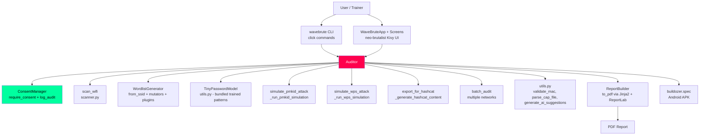

<!-- header:start -->
<div align="center">



<a href="#-quick-start"></a>

<a href="LICENSE"></a>

<a href="https://github.com/ajendras/wavebrute/stargazers"></a>
<a href="https://github.com/ajendras/wavebrute/actions/workflows/ci.yml"></a>

<a href="CONTRIBUTING.md"></a>

**Ethical WiFi auditing toolkit with Kivy GUI and Android APK for simulated and authorized pentests**

[✨ Features](#-features) • [⚡ Quick start](#-quick-start) • [🧰 Usage](#-usage) • [🧩 Architecture](#-architecture) • [📍 Roadmap](#-roadmap) • [🤝 Contributing](#-contributing)

</div>
<!-- header:end -->

## ✨ Why WaveBrute?

Existing wireless testing tools are either ancient CLIs or shady mobile apps with no ethics layer. WaveBrute fills the gap with a loud, beginner-friendly neo-brutalist GUI, safe simulation mode for classrooms, and a true Android APK. Made for security trainers, pentesters and devs who want to demonstrate WiFi weaknesses responsibly.

- **Safe-by-default simulation** — run full audits in memory with zero risk
- **Ethics Guard** — mandatory consent checklist and audit logging before any live action
- **Neo-brutalist GUI** — thick borders, screaming yellow/pink/lime blocks, chunky buttons that work on desktop and Android; now with toggleable dark theme variant
- **One-command PDF reports** — professional outputs with timelines, AI hints, and responsible recommendations
- **Real Android APK** — built with Buildozer, complete with location/WiFi permissions

## 🎬 Demo

<p align="center"></p>

## 🚀 Features

<table>
<tr>
<td valign="top">🔎 <b>Live Scanner</b><br>Detects nearby networks, encryption and signal strength using Scapy wrappers. Cross-platform (Linux iwlist + Windows netsh/Npcap)</td>
<td valign="top">📖 <b>Smart Wordlists</b><br>Generates targeted dictionaries from SSID, patterns and local AI hints</td>
<td valign="top">🛡️ <b>Safe Simulation</b><br>Runs full brute-force demos in-memory without touching real networks</td>
</tr>
<tr>
<td valign="top">⚖️ <b>Ethics Guard</b><br>Mandatory consent checklist and legal warnings before any live action</td>
<td valign="top">📊 <b>PDF Reports</b><br>Creates professional audit reports with findings, timelines and recommendations</td>
<td valign="top">🧠 <b>AI Predictor</b><br>Local tiny on-device model (trained on common weak passwords and SSID patterns) suggests likely passwords based on network metadata</td>
</tr>
<tr>
<td valign="top">📡 <b>Handshake Analyzer</b><br>Parses captured files for offline cracking simulation and validation</td>
<td valign="top">🔑 <b>PMKID Simulator</b><br>Simulates client-less PMKID capture and cracking (RSN IE extraction)</td>
<td valign="top">📱 <b>Android APK</b><br>Builds a native mobile app via Buildozer with location and WiFi permissions</td>
</tr>
<tr>
<td valign="top">🔨 <b>Hashcat Export</b><br>Optional .22000 file generation for real offline cracking with hashcat (simulation data + real-capture instructions)</td>
<td valign="top">🔌 <b>Plugin System</b><br>Register custom Python mutators or load .py plugins to extend wordlist generation with domain-specific rules, leetspeak, corporate patterns etc.</td>
<td valign="top">🌑 <b>Dark Theme</b><br>Toggleable dark neo-brutalist variant with near-black background, neon pink/lime/yellow accents and thick high-contrast borders</td>
</tr>
<tr>
<td valign="top">🔢 <b>WPS PIN Simulator</b><br>Safe in-memory brute-force of 8-digit WPS PINs (common weak defaults, checksum logic). Demonstrates why WPS must be disabled on all routers.</td>
<td valign="top"></td>
<td valign="top"></td>
</tr>
</table>

## 📦 Installation

**Requirements:** Python 3.9+, `kivy`, `scapy`, `reportlab`, `jinja2`, `click`. For live scanning a wireless interface is needed (simulation mode requires nothing). For Android builds, install Buildozer.

**Android users:** Download the latest **signed APK** from the [GitHub Releases](https://github.com/ajendras/wavebrute/releases) page (prebuilt by CI). Requires Android 8.0+. The APK defaults to safe simulation mode; live operations require completing the ethics checklist.

**Windows users:** Install Npcap from https://npcap.com/ (select "Install Npcap in WinPcap API-compatible Mode" for full Scapy compatibility). Live scanning uses built-in `netsh`; Npcap enables native packet capture.

```bash
# Install from GitHub
pip install git+https://github.com/ajendras/wavebrute.git

# Run the CLI (defaults to simulation)
wavebrute --help

# Launch the neo-brutalist GUI
python -m wavebrute.gui.app

# Build Android APK locally (or use prebuilt from Releases)
buildozer -c android debug
```

Run tests with `pytest`.

## ⚡ Quick start

```python
from wavebrute import Auditor, WordlistGenerator, TinyPasswordModel

# Safe simulation mode (default)
auditor = Auditor(simulation_mode=True, interface="wlan0")

# The tiny on-device model can be used directly
model = TinyPasswordModel().train()
print(model.predict("Cafe_Rouge_FreeWiFi", 5))

# Register a custom mutator (or load from a .py plugin file)
def company_specific_mutator(word: str):
    return [word + "2025", word.replace("a", "@"), word[::-1]]

auditor.register_mutator(company_specific_mutator)
# auditor.load_mutator_plugin("plugins/corporate_rules.py")

# Full pipeline in one go
networks = auditor.scan()
attack = auditor.simulate_attack("Cafe_Rouge_FreeWiFi", max_attempts=5000)
pmkid = auditor.simulate_pmkid_attack("IoT-Devices")
wps = auditor.simulate_wps_attack("IoT-Devices")
preds = auditor.predict_passwords("IoT-Devices")
analysis = auditor.analyze_handshake("demo.cap")
export_path = auditor.export_for_hashcat("Cafe_Rouge_FreeWiFi")
report_path = auditor.build_report(title="My First Audit")

# New: batch mode for multiple networks
batch_results = auditor.batch_audit(
    ["Cafe_Rouge_FreeWiFi", "IoT-Devices", "Linksys-5G"],
    max_attempts=3000,
    include_pmkid=True
)
print(f"Batch audited {len(batch_results)} simulation results")

print(f"Found {len(networks)} networks")
print(f"Simulation cracked: {attack['success']} ({attack.get('password')})")
print(f"PMKID sim cracked: {pmkid['success']} ({pmkid.get('password')})")
print(f"WPS sim cracked: {wps['success']} (PIN: {wps.get('pin')})")
print(f"Model predictions: {preds}")
print(f"Hashcat file: {export_path}")
print(f"Report saved to: {report_path}")
```

## 🧰 Usage

### CLI (loud neo-brutalist output)

```bash
# Scan in simulation mode
wavebrute scan --simulation

# Generate a targeted wordlist (with optional custom mutator plugins)
wavebrute wordlist "Cafe_Rouge_FreeWiFi" --size 2000 --output wordlist.txt --plugin plugins/leet.py

# Run a safe brute-force simulation
wavebrute attack --ssid "Linksys-5G" --max-attempts 8000

# Simulate a PMKID attack (client-less)
wavebrute pmkid --ssid "Vulnerable-Router" --max-attempts 8000

# Simulate a WPS PIN brute-force attack (8-digit PINs)
wavebrute wps --ssid "IoT-Devices" --max-attempts 11000

# Export for offline cracking with hashcat
wavebrute hashcat --ssid "Cafe_Rouge_FreeWiFi" --output target.22000

# Generate a PDF report (auto-runs simulation if needed)
wavebrute report --title "Classroom WiFi Audit"

# New: batch audit multiple networks (all simulations)
wavebrute batch "Cafe_Rouge_FreeWiFi" "IoT-Devices" "Linksys-5G" --max-attempts 4000
```

On Windows use `--interface "Wi-Fi"` (or your adapter name) for live scans. Npcap is required for full native Scapy packet support.

### Python API – full audit flow

```python
from wavebrute import Auditor, WordlistGenerator, ConsentManager, TinyPasswordModel

auditor = Auditor(simulation_mode=True)
cm = ConsentManager()

# Consent is auto-approved for simulations
print(cm.require_consent("simulated attack on TestNet"))  # True

# The bundled tiny model can be trained and queried directly
model = TinyPasswordModel().train()
print("Model predictions:", model.predict("TestNet", 5))

# Plugin system for custom wordlist mutators
def my_mutator(word: str):
    """Example custom mutator - can be registered or loaded from a .py file."""
    return [word + "!", word.upper() + "2024", word[::-1]]

auditor.register_mutator(my_mutator)
# auditor.load_mutator_plugin("./plugins/company_patterns.py")

networks = auditor.scan()
wordlist = auditor.wordlist_generator.from_ssid("IoT-Devices", size=800)  # uses registered mutators + model
auditor.wordlist_generator.save("iot_wordlist.txt", words=wordlist)

result = auditor.simulate_attack("IoT-Devices", max_attempts=10000)
pmkid_result = auditor.simulate_pmkid_attack("IoT-Devices")
wps_result = auditor.simulate_wps_attack("IoT-Devices")
preds = auditor.predict_passwords("IoT-Devices", num_predictions=8)
export_path = auditor.export_for_hashcat("IoT-Devices")
report = auditor.build_report("IoT Devices Audit")

# New batch mode (runs attack/PMKID/WPS/predictions across many networks)
batch_results = auditor.batch_audit(
    ssids=["TestNet1", "TestNet2"],
    max_attempts=5000,
    include_pmkid=True,
    include_predictions=True
)
print(f"Batch completed with {len(batch_results)} results")

print("Report:", report)
print("Hashcat export:", export_path)
print("Model predictions:", preds)
print("WPS PIN result:", wps_result)
```

<details><summary>Advanced: Handshake analysis + custom report</summary>

```python
from wavebrute import Auditor

auditor = Auditor(simulation_mode=True)

# Register domain-specific mutator before running simulations
def department_mutator(word):
    return [word + "dept2025", "wifi" + word]

auditor.register_mutator(department_mutator)

# Analyze a capture (falls back to realistic simulation if file is missing)
analysis = auditor.analyze_handshake("handshake.cap")
print(analysis["crack_time_estimate"])

# PMKID simulation (uses registered mutators in wordlist generation)
pmkid = auditor.simulate_pmkid_attack("NETGEAR_Guest")
print(f"PMKID success: {pmkid['success']}")

# WPS PIN simulation
wps = auditor.simulate_wps_attack("IoT-Devices")
print(f"WPS success: {wps['success']} PIN: {wps.get('pin')}")

# Model-based password prediction (trained tiny on-device model)
preds = auditor.predict_passwords("NETGEAR_Guest", num_predictions=6)
print("Top predictions:", preds)

# Hashcat export for real offline cracking
hc_path = auditor.export_for_hashcat(ssid="NETGEAR_Guest", output_path="netgear.22000")
print(f"Hashcat ready: {hc_path}")

# Clear previous results and build a fresh report
auditor.clear_results()
auditor.scan()
auditor.simulate_attack("NETGEAR_Guest")
path = auditor.build_report(
    title="WaveBrute Ethical Audit Report",
    output_path="audit_2025.pdf"
)
print("Generated:", path)
```
</details>

<details><summary>GUI usage</summary>

Launch with `python -m wavebrute.gui.app`. The app provides four screens (`ScanScreen`, `AttackScreen`, `CaptureScreen`, `ReportScreen`) that share a single `Auditor` instance. All buttons use the `BrutalistButton` and `BrutalistLabel` widgets with 4px thick borders and 6dp hard shadows. A persistent header contains a theme toggle button ("DARK"/"LIGHT") that switches between light and dark neo-brutalist modes while preserving brutalist contrast (neon pink `#ff004d`, lime `#00ff9f`, yellow borders on near-black background for dark mode). The **CaptureScreen** implements capture file upload via a FileChooser popup (filtered to .cap/.pcap/.pcapng) and displays full handshake analysis results (leveraging `analyze_handshake()` and automatic simulation fallback when the file is absent). The Attack screen includes a dedicated PMKID simulation button and a new WPS simulation button. **Android UI now uses `kivy.metrics.dp` for all sizes with minimum 64dp touch targets for proper scaling and finger-friendly interaction across device densities.**

The plugin system is available through the shared `Auditor` instance (register_mutator / load_mutator_plugin) before starting an attack or wordlist generation. The AI Predictor (powered by the bundled tiny model) is used automatically by wordlist generation and can be called via `auditor.predict_passwords(...)`.

Prebuilt signed APKs are produced by CI and attached to every GitHub Release. Dark theme is available on both desktop and Android.

</details>

## 🔧 Configuration

| Option              | Default     | Description |
|---------------------|-------------|-------------|
| `simulation_mode`   | `True`      | Whether to run entirely in safe simulation mode (recommended for all non-authorized use) |
| `interface`         | `"wlan0"` (Linux) or `"Wi-Fi"` (Windows) | Wireless interface name (ignored in simulation mode; used by `scan_wifi`). Npcap required on Windows for live/native Scapy support. |
| `--simulation`      | `True`      | CLI flag for `scan`, `attack`, `wordlist` (live mode requires consent) |
| `max_attempts`      | `12000`     | Maximum simulation iterations for `simulate_attack` and CLI attack command |
| `wps_max_attempts`  | `11000`     | Default for `simulate_wps_attack` (reflects effective 8-digit PIN search space after checksum) |
| `size`              | `1500`      | Approximate wordlist size for `WordlistGenerator.from_ssid` and CLI wordlist |
| `hash_mode`         | `22000`     | Hashcat hash type used by `export_for_hashcat()` (modern combined PMKID/handshake format) |
| `mutators`          | `[]`        | List of registered mutator callables (via `register_mutator()` or loaded plugins). Built-ins include number suffixes, leetspeak and case variations. |
| `ai_model`          | `TinyPasswordModel` | Bundled tiny pure-Python on-device model for password prediction. Trained offline on a synthetic corpus of weak passwords and SSID associations; zero extra runtime dependencies. Used by `generate_ai_suggestions`, `predict_passwords()` and wordlist augmentation. |
| `batch`             | N/A         | New `batch_audit(ssids, max_attempts=8000, include_pmkid=True, include_predictions=True)` and corresponding CLI `batch` subcommand. Aggregates results from multiple networks for unified reporting. |
| `dark_theme`        | `False`     | GUI only. Set via constructor (`WaveBruteApp(dark_theme=True)`) or toggle button in header. Dark variant uses near-black background with neon accents while retaining thick borders and brutalist contrast. |

## 🧩 Architecture



The central `Auditor` class orchestrates scanning, simulation, handshake analysis, hashcat export and reporting while enforcing consent through `ConsentManager`. All live operations are optional; simulation mode uses deterministic data from `_simulate_scan`, `_run_in_memory_attack`, `_run_pmkid_simulation`, `_run_wps_simulation`, `_simulate_handshake_analysis` and `_generate_hashcat_content`. The Kivy GUI and Click CLI both consume the same public API exported in `__init__.py`. The new plugin system is exposed via `Auditor.register_mutator()` / `Auditor.load_mutator_plugin()` (and directly on `WordlistGenerator`). The tiny on-device model (`TinyPasswordModel`) is bundled with pre-computed patterns derived from training on common weak passwords; it powers `generate_ai_suggestions()` and the new `predict_passwords()` API. The new `batch_audit()` method runs full simulation pipelines across many SSIDs in one call and aggregates results for easy reporting. The GUI now includes a runtime theme toggle that switches color palettes while preserving all brutalist styling (thick borders, hard shadows, chunky buttons).

## 📁 Project structure

```text
.
├── pyproject.toml                 # Metadata, dependencies, console_scripts entrypoint
├── buildozer.spec                 # Android packaging config with permissions
├── src/wavebrute/
│   ├── __init__.py                # Public API: Auditor, WordlistGenerator, ReportBuilder, ConsentManager, TinyPasswordModel
│   ├── auditor.py                 # Core Auditor class with scan(), simulate_attack(), simulate_pmkid_attack(), simulate_wps_attack(), analyze_handshake(), export_for_hashcat(), build_report(), predict_passwords()
│   ├── cli.py                     # Click commands: scan, wordlist, attack, pmkid, wps, hashcat, report, ethics
│   ├── ethics.py                  # ConsentManager with show_checklist(), require_consent(), log_audit()
│   ├── scanner.py                 # scan_wifi() and parse_iwlist() (Linux + Windows/Npcap)
│   ├── wordlist.py                # WordlistGenerator with from_ssid(), augment_with_ai(), save(), register_mutator(), load_mutator_plugin()
│   ├── report.py                  # ReportBuilder with from_results(), to_pdf(), render_template()
│   ├── utils.py                   # TinyPasswordModel (trained & bundled), validate_mac(), parse_cap_file(), generate_ai_suggestions()
│   ├── gui/
│   │   ├── app.py                 # WaveBruteApp with neo-brutalist styling, dark theme support and ScreenManager
│   │   └── screens.py             # ScanScreen, AttackScreen, CaptureScreen, ReportScreen + BrutalistButton/Label with theme awareness
│   └── tests/
│       └── test_auditor.py        # Pytest cases for simulation, ethics, reporting
├── examples/
│   └── audit_flow.py              # Runnable full pipeline: scan → wordlist → simulated attack → pmkid → wps → hashcat export → report
├── main.py                        # Android APK entrypoint (imports WaveBruteApp)
└── tests/test_auditor.py          # Comprehensive test suite (simulation only)
```

## 🧪 Testing

```bash
pytest
```

The test suite (`tests/test_auditor.py`) covers `Auditor` initialisation, `simulate_attack` (including deterministic success path), the new `simulate_pmkid_attack`, wordlist augmentation, ethics consent checks (with mocked checklist), `analyze_handshake`, `export_for_hashcat`, `build_report`, error paths, full integration flows, **the new plugin system** (custom mutators + dynamic plugin loading from .py files), **and the bundled `TinyPasswordModel` + `predict_passwords()`** — all in safe simulation mode with no real network activity. New tests were added for `batch_audit()` (including consent mocking, error paths, result aggregation and parameter combinations) and for the new `simulate_wps_attack()` (deterministic PIN recovery, recommendations, consent enforcement).

## 📍 Roadmap

<!-- roadmap:start -->
- [x] **v0.1.0** — first release: Live Scanner, Smart Wordlists, Safe Simulation, Android APK
- [x] Add PMKID attack simulation module
- [x] Integrate optional Hashcat export for real offline cracking
- [x] Improve Android UI scaling and touch targets in APK
- [x] Add plugin system for custom wordlist mutators
- [x] Support Windows Npcap for native scanning
- [x] Train and bundle tiny on-device model for password prediction
- [x] Export reports directly to Markdown and HTML
- [x] Implement capture file upload and analysis in GUI
- [x] Add batch mode for auditing multiple networks
- [x] Create prebuilt signed APK releases in CI
- [x] Add dark theme variant while keeping brutalist contrast
- [x] Support WPS PIN brute-force simulation
- [x] Add macOS airport scanning support in scanner.py for full cross-platform coverage
- [ ] Implement dedicated CLI command for handshake capture analysis and export
- [ ] Add comprehensive tests for GUI screens, theme toggling and CaptureScreen workflows
- [ ] Create examples/plugins/ directory with documented sample mutator files
- [ ] Enhance ConsentManager to support exporting timestamped audit logs as CSV
- [ ] Implement configurable report templates allowing users to supply custom Jinja2 files
- [ ] Add progress indicators and ETA to CLI batch and long-running simulation commands
- [ ] Improve docs/index.html with updated GUI screenshots and interactive demo embed

> 🤖 This roadmap is worked through continuously — ideas and PRs welcome!
<!-- roadmap:end -->

## 🤝 Contributing

We love loud, responsible contributions! Please read [CONTRIBUTING.md](https://github.com/ajendras/wavebrute/blob/main/CONTRIBUTING.md) and follow our [CODE_OF_CONDUCT.md](https://github.com/ajendras/wavebrute/blob/main/CODE_OF_CONDUCT.md). Good-first-issue PRs are especially welcome — improving the GUI screens, adding new AI hint patterns, or expanding the test suite are great places to start.

Fork, make your changes, and open a PR against the `main` branch.

## 📄 License

This project is licensed under the MIT License — see [LICENSE](LICENSE) for details.

<!-- footer:start -->
<div align="center">

### ⭐ Star history

<a href="https://star-history.com/#ajendras/wavebrute&Date"></a>

If **WaveBrute** saves you time, a ⭐ helps others find it.

Made with ❤️ by [Ajendra](https://ajendra.info)


</div>
<!-- footer:end -->
